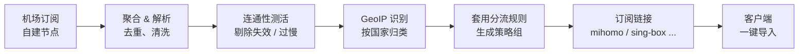

<div align="center">

# SUB-Aggregation

**一条链接，管好你所有的机场订阅。**

聚合 · 清洗 · 测速 · 分流 · 一键生成客户端配置，全部跑在你自己的 Docker 里。

[](https://github.com/bobvane/SUB-Aggregation/releases)
[](https://hub.docker.com/r/bobvane/sub-aggregation)
[](LICENSE)

[快速开始](#-快速开始) · [使用指南](#-第一次打开按这个顺序点一遍) · [常见问题](#-常见问题) · [更新日志](CHANGELOG.md) · [文档索引](docs/00_START_HERE.md)

<br>

<!-- 主图：把 src 的中文说明替换为面板整体截图的路径，例如 docs/images/xxx.png -->


</div>

---

## ✨ 它解决什么问题

手上有好几个机场订阅，节点时好时坏，客户端里一长串列表要自己挑、自己测速、自己分组？

**SUB-Aggregation** 把这些事一次性做完：

> 把所有订阅合成一份 → 自动剔除连不通和太慢的节点 → 按国家归类 → 自动测速选最快 → 输出一条能直接填进客户端的订阅链接。

原订阅换了、加节点了，这边会跟着更新，客户端刷新订阅即可。

## 🧭 工作流程



## 🎯 核心特性

| | 特性 | 说明 |
|---|---|---|
| 🔗 | **一份链接顶所有** | 多个机场、自建节点都填进来，客户端只连这一条 |
| 🧹 | **自动挑节点** | 连不通的不要，延迟超过阈值的不要，剩下的按国家分组 |
| ⚡ | **自动测速选优** | 每个国家/地区一个组，组内自动选最快的节点 |
| 🔒 | **你说了算的锁** | 某个节点看着慢但实际好用？锁定它，一定进配置 |
| 🧩 | **分流规则自己挑** | 国内直连、国外媒体、Google 服务、广告拦截……面板里勾选即可 |
| 🔄 | **自动更新** | 订阅按设定间隔自动重抓，无需手动维护 |
| 🌐 | **出网代理可控** | 订阅拉取、规则同步、版本检查、域名解析、IP 归属，五件事各自选「自动 / 代理 / 直连」；不填代理就是全部直连，零配置可用 |
| 🏠 | **数据留在本地** | SQLite 单文件存储，不经过任何第三方服务 |

## 🖼 界面一览

<!-- 下面每张图：把 src 里的中文说明替换为 docs/images 下对应截图的路径，宽度已统一设为 100% -->

<table>
  <tr>
    <td width="50%"><br><sub><b>订阅管理</b>　添加、更新、查看每个订阅的状态</sub></td>
    <td width="50%"><br><sub><b>节点列表</b>　延迟、国家、锁定 / 移出一目了然</sub></td>
  </tr>
  <tr>
    <td width="50%"><br><sub><b>分流规则</b>　勾选即用的策略组与规则目录</sub></td>
    <td width="50%"><br><sub><b>输出配置</b>　选择格式，复制订阅链接</sub></td>
  </tr>
  <tr>
    <td width="50%"><br><sub><b>系统设置</b>　更新间隔、慢节点阈值、网络代理</sub></td>
    <td width="50%"><br><sub><b>客户端效果</b>　按国家自动分组，点一下就能切</sub></td>
  </tr>
</table>

---

## 🚀 快速开始

### 准备

| 需要什么 | 说明 |
|---|---|
| 一台常年开机的机器 | NAS、小主机、VPS 均可，装好 Docker 即可 |
| 一个空端口 | 默认 `20130`，被占用就换一个 |
| 一个管理员密码 | 自己定，首次启动时写入数据库 |

### 部署（三步）

**1. 建目录并创建 `docker-compose.yml`**

```bash
mkdir -p sub-aggregation && cd sub-aggregation
```

```yaml
services:
  sub-aggregation:
    image: docker.io/bobvane/sub-aggregation:latest
    container_name: sub-aggregation
    restart: unless-stopped
    ports:
      - "20130:20130"
    volumes:
      - ./data:/data
    environment:
      ADMIN_PASSWORD: ${ADMIN_PASSWORD:-}
      SESSION_SECRET: ${SESSION_SECRET:-}
      GITHUB_TOKEN: ${GITHUB_TOKEN:-}
```

> 使用 Docker Hub 上的现成镜像，无需在本机构建。想用自己 fork 的版本，把 `image:` 换成你自己的镜像地址即可。

**2. 创建 `.env`，填两个值**

```env
ADMIN_PASSWORD=你的管理员密码
SESSION_SECRET=一串足够长的随机字符
```

```bash
# 生成 SESSION_SECRET
openssl rand -hex 32
```

**3. 启动**

```bash
docker compose pull
docker compose up -d
```

浏览器打开 `http://你的机器IP:20130/`，用 `admin` + 刚设的密码登录。

> 💡 需要外网访问时，建议配合 Tailscale 或带 HTTPS 的反向代理，不要直接把 http 端口暴露到公网。

---

## 🧑‍💻 第一次打开，按这个顺序点一遍

<table>
<tr><td width="32">①</td><td><b>设置页：先改密码</b><br>改用户名、改密码都在这里。顺手看一眼「订阅自动更新间隔」（默认 24 小时）和「慢节点抛弃阈值」（默认 2000 毫秒），不合适就改。</td></tr>
<tr><td>②</td><td><b>订阅管理：把订阅都加进来</b><br>粘贴订阅链接，点添加，重复到全部加完，再点一次「立即更新」。首次会久一点，因为要逐个查询国家并测试连通性。</td></tr>
<tr><td>③</td><td><b>节点列表：看看抓到了什么</b><br>每行一个节点，认识下面几个标记就够了（见下表）。</td></tr>
<tr><td>④</td><td><b>分流规则：挑你要的组</b><br>默认的几组（国内直连、国外媒体、Google 服务、广告拦截等）开箱即用；想加别的分类，在规则目录里搜索添加。</td></tr>
<tr><td>⑤</td><td><b>输出配置：拿订阅链接</b><br>客户端是 Mihomo / Clash 类就选 <code>mihomo</code>，sing-box 就选 <code>singbox</code>，复制给出的订阅地址。</td></tr>
<tr><td>⑥</td><td><b>客户端填链接，完事</b><br>把地址填进客户端并更新订阅。之后节点有变化，客户端重新拉取一次就是最新的。</td></tr>
</table>

### 节点列表里的标记

| 你看到的 | 含义 |
|---|---|
| **连通性延迟** | TCP/TLS 握手往返时间，越小越好；**不是**真实代理延迟 |
| **已抛弃** | 连不通，或慢于你设的阈值，默认不进入配置 |
| **锁定 / 解锁** | 锁定后**无论通不通、慢不慢都进配置**；再点一次交还给系统筛选 |
| **移出配置 / 恢复** | 手工排除，该节点不进输出订阅；点「恢复」重新参与筛选 |

> 「锁定」与「移出配置」互斥，操作其中一个会自动取消另一个。锁定的节点会排在列表最前面。「⚡ 立即测活」可手动重测全部节点。

---

## 📱 客户端里怎么用

生成的配置已经排好这些策略组，拿来就切：

| 策略组 | 作用 |
|---|---|
| **节点选择 / 手动切换** | 所有节点放在一起，想用哪个选哪个 |
| **自动选择** | 全部节点中自动测速选最快 |
| **各国家/地区组** | 🇭🇰 香港、🇺🇸 美国……每组都是自动测速，进去就是该地区最快的节点 |
| **负载均衡** | 香港 / 美国 / 马来西亚 / 日本 / 新加坡 / 台湾 / 韩国额外提供，把流量分摊到多个节点 |
| **国外媒体 / Google 服务 / 国内直连 / 广告拦截** | 按规则自动分流 |

---

## 🛠 日常维护

**升级**

```bash
docker compose pull
docker compose up -d
```

**备份与恢复**　订阅、节点、规则、账号都在 `data` 目录里。整个目录复制走就是完整备份，恢复时复制回来再启动。

**忘记管理员密码**　密码在首次启动时写入数据库，修改 `.env` 不会生效。唯一办法是删除 `data` 目录后重启，代价是订阅和配置需要重新添加，所以建议一开始就记好。

---

## ❓ 常见问题

<details>
<summary><b>面板打不开</b></summary>

先用 `docker compose ps` 确认容器在运行，再确认端口（默认 20130）没被占用，最后检查访问的 IP 与防火墙设置。
</details>

<details>
<summary><b>很多节点掉进了「其他」组</b></summary>

这些节点的服务器地址是域名，容器无法判断它们所属国家。让容器能出网即可：进入「设置 → 网络代理」，填上代理的 IP 和端口（端口不填则尝试 7893），「IP 归属」和「域名解析」保持默认的「自动」（先直连，不通再走代理），然后点「测试代理」确认可用。节点测活始终直连，不受影响。
</details>

<details>
<summary><b>某个节点明明好用，却被标成「已抛弃」</b></summary>

手动测活偶尔会遇到网络抖动。点该节点的「锁定」，它就会一直进入配置，不再被自动淘汰。
</details>

<details>
<summary><b>国家组为什么不能手选节点？</b></summary>

这是有意的设计：每个国家组都是自动测速组，进去就是该地区最快的节点，无需手动挑选。
</details>

---

## 📚 文档与开发

| 想了解 | 阅读 |
|---|---|
| 代码结构、数据流、出网策略 | [docs/ARCHITECTURE.md](docs/ARCHITECTURE.md) |
| HTTP 路由与字段约定 | [docs/API.md](docs/API.md) |
| 协议解析与配置生成 | [docs/PARSING_AND_GENERATION.md](docs/PARSING_AND_GENERATION.md) |
| 分流规则与 Mihomo DNS | [docs/RULES_AND_DNS.md](docs/RULES_AND_DNS.md) |
| 节点探测与 GeoIP | [docs/NODE_HEALTH.md](docs/NODE_HEALTH.md) |
| 安全边界与检查项 | [docs/SECURITY_AND_TESTING.md](docs/SECURITY_AND_TESTING.md) |
| 维护与发布约定 | [docs/MAINTENANCE.md](docs/MAINTENANCE.md) |

完整索引见 [docs/00_START_HERE.md](docs/00_START_HERE.md)，版本发布规则见 [CONTRIBUTING.md](CONTRIBUTING.md)。

**本地构建**

```bash
npm ci
npm run build:html     # 修改过 public/index.html 时需要
npm run build:server
npm start              # 开发期可用 npm run dev
```

---

## 🙏 致谢

- [MetaCubeX](https://github.com/MetaCubeX)：分流规则与 Mihomo 生态
- [cmliu / CF-Workers-SUB](https://github.com/cmliu/CF-Workers-SUB)：订阅聚合的思路来源

## 📄 License

[MIT](LICENSE) © [Bob Vane](https://github.com/bobvane)
